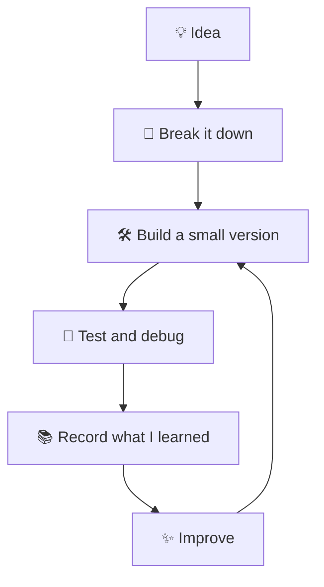

<!--
  ADITYA KR VERMA — GITHUB PROFILE
  A celestial / fairy-tech developer portfolio.
  Personalize the name, links, and project descriptions to keep everything accurate.
-->

<div align="center">

  

  <br />

  

  <br />

  
  
  

  <br /><br />

  <a href="https://github.com/aditya-kr-verma">
    
  </a>
  <a href="https://github.com/aditya-kr-verma?tab=followers">
    
  </a>

  <br /><br />

  <a href="#-the-origin-story">✧ Origin</a> •
  <a href="#-my-arcane-toolkit">✧ Toolkit</a> •
  <a href="#-projects-from-my-workshop">✧ Projects</a> •
  <a href="#-the-github-observatory">✧ Observatory</a> •
  <a href="#-send-a-signal">✧ Connect</a>

</div>

---

<div align="center">

## ✦ WELCOME TO MY LITTLE CORNER OF THE DIGITAL COSMOS ✦


*Where logic meets imagination, and every commit is another tiny spell.*

</div>

## 🪄 The Origin Story

```javascript
const aditya = {
  name: "Aditya Kr Verma",
  github: "aditya-kr-verma",
  identity: "Student | Software Development Explorer",
  knownLanguages: ["HTML", "CSS", "JavaScript", "SQL"],
  currentlyExploring: [
    "System Design",
    "Better Software Architecture",
    "APIs and Data",
    "Building Useful Products"
  ],
  superpower: "Curiosity",
  currentQuest: "Turn ideas into working software",
  motto: "Stay curious. Build boldly. Keep becoming."
};

console.log("The journey is loading... ✨");
```

I'm a student exploring software development, fascinated by the space between **an idea and a working product**.

I enjoy creating for the web, learning how applications behave behind the scenes, understanding data, and exploring the design decisions that make software reliable.

I'm not here to pretend I've mastered everything. I'm here to learn the fundamentals, build real things, ask better questions, and keep improving.

- 🌌 **Frontend:** I enjoy shaping interfaces with HTML, CSS, and JavaScript.
- 🧠 **Systems thinking:** I'm exploring SQL, system design, and how software components fit together.
- 🛠️ **Builder energy:** I want each project to teach me something I can use in the next one.
- 🧭 **Growth mindset:** New technologies are invitations to explore, not boxes to tick.
- 🤝 **Community:** I'm interested in meeting curious developers and learning through collaboration.

<div align="center">

> ✨ *I may still be writing my origin story, but the next chapter is already compiling.*

</div>

---

## 🔮 The Developer's Spellbook

<div align="center">

| ✦ | Focus | Current quest |
|---|---|---|
| `01` | Web foundations | Build accessible, responsive interfaces |
| `02` | JavaScript | Write clearer logic and useful interactions |
| `03` | SQL | Understand queries, relationships, and data |
| `04` | System design | Learn components, trade-offs, and scalability |
| `05` | Engineering habits | Improve debugging, Git, testing, and documentation |

</div>

### Current quests

- [ ] Build more projects from a blank file, not just from tutorials.
- [ ] Practice modern JavaScript and asynchronous code.
- [ ] Strengthen responsive design and accessibility.
- [ ] Practice SQL joins, constraints, and relational modelling.
- [ ] Understand HTTP, APIs, and client-server communication.
- [ ] Explore caching, queues, reliability, and system design trade-offs.
- [ ] Learn testing and improve code maintainability.
- [ ] Make my first meaningful open-source contributions.

<details>
  <summary><strong>🌙 Quest log: how I like to learn</strong></summary>

  <br />

  1. Find a problem worth solving.
  2. Break it into small pieces.
  3. Build the simplest working version.
  4. Debug until I understand the cause.
  5. Write down what I learned.
  6. Improve the design and try again.

</details>

---

## 🧙 My Arcane Toolkit

### The core elements

<div align="center">

  

  <br /><br />

  
  
  
  

</div>

### My workshop

<div align="center">

  

</div>

| Tool / topic | What I'm learning or using it for |
|---|---|
| HTML | Meaningful document structure and accessibility |
| CSS | Layout, responsive design, motion, and visual hierarchy |
| JavaScript | Browser behavior, DOM, events, and application logic |
| SQL | Querying and working with relational data |
| Git | Tracking changes and experimenting safely |
| GitHub | Sharing projects, collaboration, and documentation |
| VS Code | My everyday coding workspace |
| System design | How software pieces communicate and scale |
| UI exploration | Turning rough ideas into clear interfaces |

### Elements I am exploring

<p align="center">
  
  
  
  
  
</p>

<sub>Skill badges describe my learning areas, not a claim of mastery.</sub>

---

## 🏰 Projects From My Workshop

<div align="center">

*Every project is a portal: a problem on one side, a new lesson on the other.*

</div>

<!-- Replace these sample cards with your actual repositories and project descriptions. -->

<table>
  <tr>
    <td width="50%" valign="top">

      <h3>🌿 Project One — The Web Realm</h3>

      A responsive website with a thoughtful visual identity, clear navigation, and interactive details.

      <br /><br />

      
      
      

      <br /><br />

      **Quest:** Build a smooth and accessible user experience.

      <br />

      <a href="https://github.com/aditya-kr-verma">Explore my repositories →</a>

    </td>
    <td width="50%" valign="top">

      <h3>🗃️ Project Two — The Data Vault</h3>

      A database practice project exploring tables, queries, relationships, and meaningful data retrieval.

      <br /><br />

      
      

      <br /><br />

      **Quest:** Turn raw data into useful answers.

      <br />

      <a href="https://github.com/aditya-kr-verma">Explore my repositories →</a>

    </td>
  </tr>
  <tr>
    <td width="50%" valign="top">

      <h3>⚡ Project Three — The JavaScript Forge</h3>

      A small web tool that solves one clear problem with practical JavaScript and a polished interface.

      <br /><br />

      
      

      <br /><br />

      **Quest:** Make the browser do something useful.

      <br />

      <a href="https://github.com/aditya-kr-verma">Explore my repositories →</a>

    </td>
    <td width="50%" valign="top">

      <h3>🧪 Project Four — The Experimentarium</h3>

      A home for prototypes, notes, small experiments, and ideas that grow into something bigger.

      <br /><br />

      
      

      <br /><br />

      **Quest:** Learn by making, testing, and refining.

      <br />

      <a href="https://github.com/aditya-kr-verma">Explore my repositories →</a>

    </td>
  </tr>
</table>

### What belongs in a featured project?

- A clear purpose and real problem.
- A screenshot or demo that works.
- A readable README with setup instructions.
- An honest list of technologies used.
- Meaningful commits and understandable code.
- A short note about challenges and lessons learned.

---

## 🌠 The GitHub Observatory

<div align="center">

  

  

  <br /><br />

  

  <br /><br />

  

</div>

<sub>These cards are generated by external services. They may load slowly, hit rate limits, or display incomplete information. Language charts reflect repository contents, not your full skill level.</sub>

---

## 🐍 The Contribution Serpent

<div align="center">

  

</div>

<details>
  <summary><strong>🛠️ Unlock the animation</strong></summary>

  The snake image needs a GitHub Actions workflow to generate and publish the SVG. Until you configure it, the image may appear broken.

  Setup instructions: [Platane/snk on GitHub](https://github.com/Platane/snk).

</details>

---

## 🖥️ Transmission From My Terminal

```text
╭────────────────────────────────────────────────────╮
│  ADITYA@DEV-REALM  ::  PERSONAL STATUS             │
├────────────────────────────────────────────────────┤
│  CLASS       Student / Developer in progress       │
│  ELEMENTS    HTML · CSS · JavaScript · SQL          │
│  QUEST       Explore system design                 │
│  PASSION     Ideas that become useful software     │
│  DIRECTIVE   Learn → Build → Debug → Improve       │
╰────────────────────────────────────────────────────╯
```

```javascript
while (curiosity) {
  learnSomething();
  buildSomething();
  breakSomething();
  debugUntilItMakesSense();
  improveWhatYouBuilt();
}
```

<div align="center">


</div>

---

## 🧭 My Engineering Compass

| Principle | What it means to me |
|---|---|
| Clarity over cleverness | Make code easier for another person to understand |
| Curiosity over ego | Ask questions and accept feedback |
| Practice over performance | Build useful things instead of only looking impressive |
| Fundamentals over hype | Understand the ideas behind the tools |
| Progress over perfection | Start small, test, and iterate |
| Collaboration over isolation | Share knowledge and learn from other people |

### The way I approach a challenge



---

## 📖 The Learning Grimoire

<details>
  <summary><strong>🌐 Frontend — make the interface feel alive</strong></summary>

  <br />

  - Semantic HTML and accessible structure
  - Responsive CSS and layout systems
  - Motion that helps rather than distracts
  - JavaScript events and browser APIs
  - Loading, error, and empty states
  - Performance and usability fundamentals

</details>

<details>
  <summary><strong>🗄️ Data — make information useful</strong></summary>

  <br />

  - SELECT, WHERE, ORDER BY, and GROUP BY
  - Joins and relationships
  - Primary and foreign keys
  - Constraints and data integrity
  - Schema design fundamentals
  - Query readability and performance basics

</details>

<details>
  <summary><strong>🏗️ System design — understand the bigger picture</strong></summary>

  <br />

  - Clients, servers, and APIs
  - Databases and data flow
  - Caching and queues
  - Reliability and failure scenarios
  - Scaling concepts
  - Trade-offs instead of one-size-fits-all answers

</details>

<details>
  <summary><strong>🔧 Engineering craft — make the work maintainable</strong></summary>

  <br />

  - Git history and useful commit messages
  - Debugging with small reproducible examples
  - Basic testing habits
  - Refactoring and naming
  - Documentation that helps the next person
  - Protecting secrets and configuration

</details>

---

## 🦋 A Few Notes From the Creator

<details>
  <summary><strong>Why the fairy-tech aesthetic?</strong></summary>

  <br />

  I like the idea that technology can feel imaginative without losing its logic. The stars represent curiosity, the glow represents ideas taking shape, and the code is the craft that brings them to life.

</details>

<details>
  <summary><strong>What does “developer in progress” mean?</strong></summary>

  <br />

  It means I am actively learning, building, making mistakes, improving my understanding, and creating a record of that journey. It is not a claim that I know everything.

</details>

<details>
  <summary><strong>What am I hoping to find here?</strong></summary>

  <br />

  Interesting projects, thoughtful developers, opportunities to collaborate, and ideas that make me curious enough to open my editor.

</details>

---

## 💌 Send a Signal

<div align="center">

  <a href="https://github.com/aditya-kr-verma">
    
  </a>

  <!-- Add your real LinkedIn URL if you want to share it publicly. -->
  <!-- <a href="https://www.linkedin.com/in/YOUR_LINKEDIN/"> -->
  <!--    -->
  <!-- </a> -->

  <!-- Add a public email only if you're comfortable sharing it. -->
  <!-- <a href="mailto:YOUR_EMAIL"> -->
  <!--    -->
  <!-- </a> -->

  <br /><br />

  *If you're building something interesting, I would love to discover it.*

</div>

---

<div align="center">

  

  <h3>✦ Stay curious. Make beautiful things. Keep shipping. ✦</h3>

  <p><code>console.log("The next level is built, not wished for.");</code></p>

  <sub>Crafted with curiosity by Aditya Kr Verma • HTML • CSS • JavaScript • SQL</sub>

</div>

<!--
╔══════════════════════════════════════════════════════════════════════╗
║                      FINAL PERSONALIZATION CHECK                    ║
╠══════════════════════════════════════════════════════════════════════╣
║ 1. Save this as README.md in the repository named aditya-kr-verma.   ║
║ 2. Confirm the repository is public.                                 ║
║ 3. Replace sample project descriptions with actual project links.   ║
║ 4. Add real LinkedIn/email links only if you want them public.       ║
║ 5. Configure the snake workflow if you want that animation.         ║
║ 6. Check image loading after committing.                             ║
║ 7. Remove any section that doesn't represent your journey.           ║
║                                                                      ║
║ NOTE: GitHub README supports a subset of HTML and does not run        ║
║ arbitrary JavaScript or CSS. Animations here use remote SVG/GIF       ║
║ services, so some depend on external availability and their limits.  ║
╚══════════════════════════════════════════════════════════════════════╝
-->
